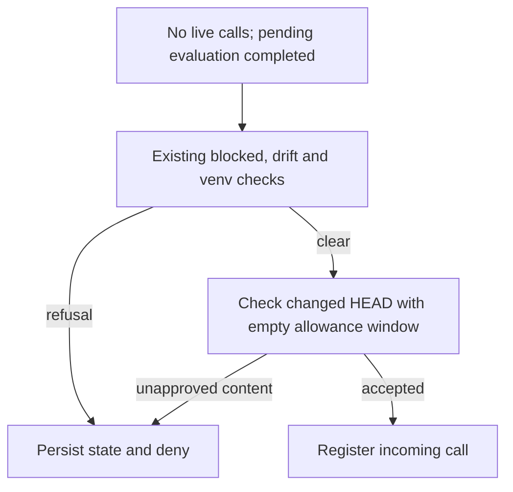

# Guard HEAD Admission Check - Plan

---

## Goal Capsule

- **Objective:** Developers cannot silently continue agent work after an unapproved protected-file commit.
- **Means:** Validate changed HEAD contents through the existing commit approval check (KTD1).
- **Authority:** `AGENTS.md`, then this plan's R-IDs, then the KTDs, then the units.
- **Stop conditions:**
  - Stop if the new blocking tests pass before the production change.
  - Stop if the fix appears to need new config, state fields, protocol changes or edits to the template stubs.
  - Stop if the user does not approve the protected-file edit.
- **Execution profile:** Lightweight, 2 units. Tests come first.
- **Finish and ship:** The executor commits on a `codex/…` or `fix/…` branch. The user decides whether to push or open a PR.

---

## Product Contract

### Summary

At admission, the guard will compare the protected contents of the recorded HEAD and current HEAD against existing approval history before allowing the next call. A commit with unapproved protected content leaves a lasting block. Approved commits and commits that don't touch protected files are admitted as before.

### Problem Frame

`pre_drift_refusal` sets `state["head"] = head(repo)` at `scripts/hooks/guard_config.py:1059` without first checking committed protected content. `drift()` compares the worktree with the baseline and the index with the current HEAD. It never compares the old commit with the new one.

So suppose an unapproved commit changes a protected file, the worktree is reverted to the approved content, and the index matches the new commit. Then an unknown or duplicate completion arrives. It correctly does nothing: there is no entry, so the window stays empty and no evaluation runs. The next normal call then overwrites the old HEAD, and `check_head` loses what it needs to detect the change. This was found by code review; no regression test has run yet.

### Requirements

**Admission**
- R1. Admission must not silently accept a changed HEAD containing unapproved protected content; refusal must persist even if the evaluated HEAD is recorded.
- R2. Committed protected content that is neither the previous commit's content nor in `state["approved"]` refuses the call. The refusal persists across later calls.
- R3. Neither the incoming call's allowances nor unknown or duplicate completions approve past commits.
- R4. Commits with approved protected content, and commits that touch no protected file, are admitted.

**Preservation**
- R5. Completion handling, `make guard-accept-changes` and the history routes keep their current behavior.
- R6. Generated projects inherit the fix through the existing include stubs, with no duplicated code.

### Key Decisions

- **Judge commits with the existing approval rules; do not block every HEAD change.** Approved commits have to keep working. Governs R2, R4.

### Acceptance Examples

- AE1 (covers R1–R3): The baseline is recorded. A protected file is committed with unapproved content outside the hooks, the worktree is reverted, and the index equals HEAD. An **unknown** completion returns `{}`. The next pre `git switch main` is denied with "A commit recorded unapproved changes to pyproject.toml". A following pre `true` is also denied. Runs under Claude and Codex.
- AE2 (covers R1–R3): Same as AE1, but the completion is a **duplicate** post of a completed plain commit call with a HEAD allowance. Replay must not restore that allowance.
- AE3 (covers R4): A Claude Write that the user approved changes `pyproject.toml`. The user commits it outside the hooks. The next pre is admitted. Codex has no approved-edit route, so the approval comes from Claude; the admitting call runs under both clients.
- AE4 (covers R4): A commit changes only `src/app.py`. The next pre is admitted under both clients.

### Scope Boundaries

- Out of scope: new config, MCP, state migrations, changes to the hook protocol, git history rewriting, refactoring `evaluate`, a full extra test matrix, and edits under `template/`.
- This change does not add an independent HEAD audit to `stop()` or walk intermediate commits. Existing evaluation paths remain unchanged; R1 addresses admission. Full-history auditing is a separate policy decision.

### Sources

- `scripts/hooks/guard_config.py:995-1060`: `admit` and `pre_drift_refusal`.
- `scripts/hooks/guard_config.py:1211-1229`: `check_head`.
- `scripts/hooks/guard_config.py:784-805`: `finish_call` and `live_calls`.
- `scripts/hooks/guard_config.py:1070-1097`: `post_tool`; a missing entry does not trigger evaluation.
- `tests/test_guard.py:390-397`: the existing late-post test covers the worktree only.
- `tests/test_guard.py:610-620`: the existing pattern for blocking after a commit.
- `tests/test_copier.py:121-131`: the include-stub parity test.

**Evidence check:** The evidence agrees with the user's finding. One refinement: the completion events don't cause the bug. Any admission without an evaluation first leaves the same gap. The fix at admission closes it in general, and the tests use the completion events the user asked for.

---

## Planning Contract

### Key Technical Decisions

- KTD1. **Reuse `check_head` at admission.** In `pre_drift_refusal`, replace the unchecked HEAD assignment with the existing `check_head` check, supplying the protected path set and an empty allowance window. Propagate its refusal through the existing admission denial/save path (R1, R2).
  - `check_head` already handles commit-only paths, unborn HEADs and approval history.
  - On a violation, `check_head` also advances the HEAD. That is safe only because the same evaluation also sets `state["blocked"]`, and the refusal branch of `admit` (`guard_config.py:1019-1022`) saves the state. Later calls then stop at the `state.get("blocked")` check, so the old HEAD is no longer needed. The dangerous case is the current unchecked overwrite.
- KTD2. **Pass an empty window.** The incoming call's allowances are registered only after admission. Passing `[]` keeps its `head` allowance from excusing an earlier commit (R3). The existing reference-content and approval-history rules decide acceptance; nothing new is approved.
- KTD3. **Keep the call where line 1059 is now.** It stays after the drift and venv refusals, which return early and leave HEAD unchanged, as they do today. `admit` already skips `pre_drift_refusal` for `guard-accept-changes`, and `accept()` takes a fresh snapshot of HEAD (R5).
- KTD4. **Change only the root files.** `template/scripts/hooks/guard_config.py.jinja` and `template/tests/test_guard.py.jinja` include the root files (R6).

### High-Level Technical Design

The existing accept-changes exception remains outside this path (R5).

### Implementation Constraints

`scripts/hooks/` is protected. Prepare the exact protected-file diff before implementation approval. Under Codex, the user applies that diff through the documented human route; under Claude Code, an approved Edit is available. Do not modify the active guard or its baseline through an agent-side workaround. Per `AGENTS.md`, guard policy changes require user authorization. `tests/test_guard.py` is not protected.

### Sequencing

U1 (red) comes before U2 (green). U2 must not start until the AE1 and AE2 failures on the current code have been recorded.

---

## Implementation Units

### U1. Regression tests for HEAD admission

- **Goal:** Reproduce the lost-HEAD gap and fence off over-blocking.
- **Requirements:** R1–R5, AE1–AE4.
- **Files:** `tests/test_guard.py`.
- **Approach:**
  - Add a test parametrized over `completion ∈ {unknown, duplicate}` × `client ∈ {claude, codex}`, plus one admission test for each of AE3 and AE4. Put them next to the commit tests near `tests/test_guard.py:610`.
  - Initialize the baseline through a completed normal call. For AE2, use a completed plain empty commit and retain its payload for replay; record the baseline HEAD after that call. Construct the later unapproved commit only in the disposable fixture using the existing Git plumbing pattern (`hash-object`, `update-index`, `write-tree`, `commit-tree`, `update-ref`), without a corresponding tool pre/post pair. Leave the index at that commit and restore only the worktree to baseline content. The fixture pre-commit hook would reject a normal unapproved commit, so do not disable it or accidentally exercise that earlier refusal instead.
- **Test Scenarios:**
  - **Fixture asserts for AE1/AE2, checked before any completion:**
    - `git show HEAD:pyproject.toml` returns the unapproved content.
    - `git diff --cached --quiet` succeeds, so the index equals HEAD.
    - The worktree file equals `PROTECTED_CONTENT`.
    - `git rev-parse HEAD~1` equals the baseline HEAD.
  - **Admission assert for AE3/AE4:** before the pre call, assert that HEAD differs from the baseline HEAD and that no hook event ran after the commit. This proves the test reaches admission with a changed HEAD instead of passing through ordinary post evaluation.
- **Verification:** Before U2, AE1 and AE2 fail with pre returning `{}`; AE3 and AE4 pass.

### U2. Check HEAD before advancing it at admission

- **Goal:** Close the gap per KTD1–KTD3.
- **Requirements:** R1–R6.
- **Dependencies:** U1 failures recorded.
- **Files:** `scripts/hooks/guard_config.py` (production scope: `pre_drift_refusal`); `tests/test_guard.py` (U1 regressions).
- **Approach:** Make the change described in KTD1, through the protected-file route in Implementation Constraints.
- **Test Scenarios:**
  - U1 tests satisfy AE1–AE4 after the production change.
  - Existing completion, accept, history and commit tests in `tests/test_guard.py` still pass.
  - The existing include-stub test renders the changed root guard and tests byte-for-byte (R6).
- **Verification:** See the Verification Contract.

---

## Verification Contract

| Gate | Command | When |
|---|---|---|
| Red proof | `make test-one TEST=tests/test_guard.py::<new AE1/AE2 test>` must fail | After U1, before U2 |
| Green proof | `make test-one TEST=tests/test_guard.py::<each new test>` | After U2 |
| Guard regressions | `make test-one TEST=tests/test_guard.py` | After U2 |
| Template parity | `make test-one TEST=tests/test_copier.py::test_include_stubs_render_their_root_file_exactly` | After U2 |
| Routine gates | The pre-commit hook (lint, format, `make typecheck`); pre-push runs `make check` and `make docs-build` | On commit and push; don't rerun by hand |

None of these results exist yet. Both the red and the green results must be produced and reported during execution.

---

## Definition of Done

- AE1 and AE2 have recorded failures before the fix and passes afterwards; AE3 and AE4 pass on both versions.
- R1–R6 are covered by the passing tests listed above. No template file changed.
- The production diff is limited to `pre_drift_refusal` and went in through the protected-file route in Implementation Constraints.
- Code from abandoned attempts is removed. Nothing has been published without the user's decision.
