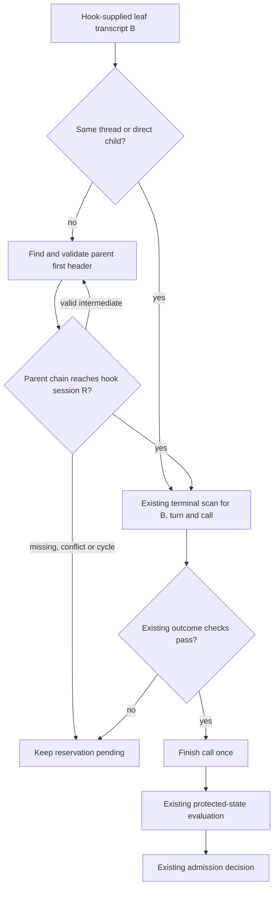

# Nested Guard Completion - Plan

## Goal Capsule

- **Objective:** A completed nested agent command stops blocking the user's next legitimate command or commit.
- **Means:** Extend the existing transcript ancestry binding (KTD1–KTD3).
- **Authority:** Product Requirements govern behavior; Key Technical Decisions govern implementation within those requirements; units override neither. Repository development and protected-edit rules remain applicable.
- **Execution profile:** Reproduce the nested regression before changing the guard, then verify recovery through its existing hook interface.
- **Stop conditions:** Stop if the implementation needs weaker completion evidence, a guard-state reset, a host setting, or a separate execution service.
- **Ownership:** The implementation owner completes U1–U2 and their verification. Publishing and releases remain separately authorized actions.

---

## Product Contract

### Summary

Recognize completion from nested Codex agents by proving their ancestry reaches the hook session, then applying the existing terminal-result checks.
The same recovery must work for reservations saved before the fix.

### Problem Frame

In v0.2.2, a leaf transcript B may report parent A while the hook identifies root R.
The guard recognizes only the same thread or one direct child, so it never reads B's valid completion and refuses subsequent exclusive calls.
A private diagnostic reproduced both next-commit refusal and failure to recover a serialized two-hour-old call; six root/direct/unrelated controls passed.
This is synthetic transcript evidence through the current test harness, not a new live nested-host experiment.

### Requirements

**Completion and identity**

- R1. A completed command from B → A → R must release its reservation when the hook session is R; the rule also applies to deeper finite ancestry.
- R2. Every intermediate relationship must be supported by matching transcript-header identity. Missing, unrelated, cyclic, contradictory or otherwise unverifiable ancestry must leave the call pending without granting an allowance.
- R3. Completion must retain the existing call ID, turn ID, leaf thread ID, item type, source, status, exit-code and process-evidence checks.

**Recovery and compatibility**

- R4. Existing saved nested reservations must recover through ordinary reconciliation without clearing state, resetting the baseline or requiring new saved fields.
- R5. Root/direct-child, legacy-history, partial-record and yielded-command behavior must remain compatible. Age alone must not close a pending paginated command.
- R6. Releasing a reservation must retain existing outcome allowances and protected-state evaluation before admitting a new call.
- R7. The root repository and generated repositories must receive the same fix without new host settings, dependencies, Make targets or operator repair steps.

### Acceptance Examples

- AE1. **Covers R1, R3, R6.** Hook session R reserves B's command; B's header points to A and A's header to R. A matching successful terminal item arrives. The next plain commit pre-hook is accepted when protected state is otherwise valid.
- AE2. **Covers R2, R3.** The same terminal item under B → A → X does not close R's reservation. A valid ancestry chain with a wrong turn, call or leaf thread also stays pending.
- AE3. **Covers R4, R5.** A serialized pre-fix nested entry, older than the legacy timeout and without reader fields, closes from terminal evidence already in its transcript after upgrading.
- AE4. **Covers R6.** B finishes after an unauthorized protected-file write. Its reservation closes, but the existing evaluation restores/refuses that change before a commit can proceed.

### Scope Boundaries

The implementation covers ancestry lookup and its interaction with existing completion recovery.
It does not relocate a missing leaf transcript, infer completion from OS process liveness, expire pending calls, add persistent ancestry storage, or redesign Claude completion handling.
A new real-host harness and a broad Copier generation matrix are not required for this bounded fix; existing deterministic hooks and include-parity coverage prove its changed behavior.

---

## Planning Contract

### Key Technical Decisions

- KTD1. **Extend the current binding seam.** Keep root and direct-child fast paths in `rollout_thread()` and add ancestor resolution only for otherwise-unbound headers. Walk upward with a visited-ID set until the saved hook session is reached. Return the original leaf ID B, never an ancestor ID. A direct edge to R needs no extra R transcript. Governs R1–R3, R5.
- KTD2. **Use the existing Codex session stores.** Reuse `codex_home()` for `CODEX_HOME` / the current default. Discover parent candidates only beneath `sessions/` and `archived_sessions/`, across date directories. Build a lazy filename index once per reconciliation, share it among that reconciliation's calls, and discard it afterward. Match a literal `-<parent-id>.jsonl` suffix on `rollout-` filenames; never interpolate an ID into a path or glob. Directory traversal must not follow symlinks; candidate files must resolve inside a permitted store and be regular files. Filenames locate candidates but do not prove identity. Governs R2, R7.
- KTD3. **Validate first headers, not replayed history.** Read only the first complete JSON line of each exact-ID candidate using the existing bounded-header policy. Require `session_meta`, exact nonempty `payload.id`, and a nonempty string parent for every edge traversed. Intermediate headers establish only ancestry; their events never supply completion. Multiple candidates are usable only when all candidates are readable and valid and their normalized `(id, parent_thread_id)` evidence agrees. Conflicts, malformed candidates and lookup errors return pending. Retain the leaf's current history-mode handling. Governs R2, R3, R5.
- KTD4. **Avoid permanent false negatives and new persistent state.** Revalidate ancestry on each reconciliation, including after a parent is archived, replaced or becomes available. Cache only within that reconciliation. Enumerate candidate filenames once, read only matching headers, and use the visited set to terminate cycles. Do not introduce an arbitrary depth/file-count cutoff or a first-page lookup that permanently hides valid ancestors. Keep the existing leaf scan byte budget. Governs R1, R2, R4.
- KTD5. **Recover saved calls through the existing reader.** Existing calls continue through `command_completion(..., starting=False)`. Never initialize recovered entries at EOF or advance their leaf cursor while ancestry is unverified. Preserve the existing file-identity/truncation reset and admission-only `starting=True` behavior. Leave `command_outcome()`, `finish_call()` and pending-timeout semantics unchanged. Governs R3–R6.

### High-Level Technical Design

The ancestry walk uses headers from B and its intermediates; the terminal scan remains on B's already-open transcript.
The transient filename index changes lookup cost, not which session is trusted.

### Risks and Implementation Constraints

- Codex rollout layout is a host-owned file contract. Local headers confirm the current date-directory and archive layout; filename identity still requires header validation. Unknown formats remain pending rather than falling back to expiry.
- Large session stores add filename traversal cost. Lazy indexing and header-only candidate reads avoid parsing unrelated transcripts. Verify this with instrumented tests; do not claim a wall-clock bound from planning evidence.
- Approval policy still governs the protected guard edit. Prepare the exact production diff for the existing approved route; the planning artifact itself does not authorize bypassing that policy.
- `template/scripts/hooks/guard_config.py.jinja` and the corresponding test stubs include root files. There is no second guard implementation to patch.

### Sources and Existing Patterns

- `scripts/hooks/guard_config.py`: `codex_home`, `rollout_thread`, `command_completion`, `scan_command_completion`, `live_calls`, `admit`.
- `tests/test_guard_completion.py`: `Rollout`, identity/result checks, replayed metadata, replacement/truncation and reader-offset cases.
- `tests/test_guard.py`: isolated `Project` fixture, yielded-post reservation and recovered protected-write cases.
- `tests/test_copier.py`: `test_include_stubs_render_their_root_file_exactly`.
- Prior diagnostic at v0.2.2 / commit `077b30e`: two nested regressions failed, six controls passed. Assertions must be promoted into realistic session-layout fixtures; the private probe's arbitrary parent filenames are not a host contract.

---

## Implementation Units

### U1. Bind nested leaf transcripts to the hook session

**Goal:** Resolve valid ancestry while refusing unverified relationships.

**Requirements:** R1–R3, R5, R7. **Dependencies:** None.

**Files:** `scripts/hooks/guard_config.py`, `tests/test_guard_completion.py`.

**Approach:** Extend the binding and parent-discovery seam under KTD1–KTD4. Pass a transient lookup context through existing completion calls where needed; inspect all call sites before changing signatures. Keep test discovery under an isolated `CODEX_HOME` with host-shaped filenames.

**Execution note:** Begin with the failing nested case and positive root/direct controls before applying the protected production change.

**Patterns to follow:** Existing first-header parsing and `Rollout` helpers; existing pending results for unverified evidence.

**Test scenarios:**

1. Covers AE1. B → A → R and a deeper chain close only the matching call, retaining B as the terminal identity.
2. Root/direct-child behavior and supported leaf history modes remain unchanged.
3. Parent headers in another date directory or `archived_sessions/` resolve correctly.
4. Covers AE2. Unrelated root, missing parent, invalid parent type, self-cycle and multi-node cycle remain pending.
5. A correct-looking filename with the wrong header ID, malformed/partial/oversized first header, unreadable candidate or path outside permitted stores cannot prove ancestry.
6. Identical duplicate ancestry is accepted; conflicting or invalid duplicates remain pending regardless of discovery order.
7. A later replayed parent header cannot replace the file's first-header identity.
8. With valid nested ancestry, wrong call/turn/leaf thread and invalid terminal outcomes remain pending. Valid success/failure/no-execution outcomes keep their existing allowance behavior.
9. Multiple pending calls share one discovery pass; unrelated transcript bodies are never opened. Valid ancestry beyond a populated directory is not silently hidden by a lookup cutoff.

**Verification:** New ancestry cases pass alongside the existing completion suite, without weakening result matching or adding persistent guard fields.

### U2. Prove persisted recovery and hook admission

**Goal:** Existing and new nested calls recover through normal hooks while protected writes remain controlled.

**Requirements:** R1, R2, R4–R7. **Dependencies:** U1.

**Files:** `tests/test_guard.py`, `tests/test_guard_completion.py`; verify `tests/test_copier.py` and existing template include stubs. Production integration adjustments remain confined to `scripts/hooks/guard_config.py` if needed under KTD5.

**Approach:** Promote the diagnostic assertions into permanent tests using the isolated subprocess fixture. Exercise persisted reservations and normal pre/post reconciliation, then check the following exclusive call. Reuse current protected-state evaluation and template includes.

**Test scenarios:**

1. Covers AE1. A nested successful terminal event permits the next plain commit pre-hook. The same leaf reported under an unrelated hook session stays blocked.
2. Covers AE3. Save and reload an old nested entry without reader or ancestry fields; an already-written terminal record closes it without EOF initialization.
3. A parent missing on the first check appears later; normal reconciliation then finds the previously written completion. Failed ancestry checks must not consume the terminal record.
4. Replace a previously valid ancestor with unrelated metadata; later reconciliation must not reuse cached trust. Moving the parent to the archive must retain recoverability when discovery sees a complete valid copy.
5. Covers AE4. Recovery after an unauthorized protected write restores/refuses the change; no extra allowance is granted.
6. Repeated completion checks do not duplicate allowance consumption; genuinely yielded commands remain reserved.
7. All include stubs still render byte-identically to their root sources and tests.

**Verification:** Both completion and hook suites pass, including saved-state recovery, and include-parity passes. Test helpers use realistic filenames and explicitly report hook session R rather than accidentally selecting immediate parent A.

---

## Verification Contract

- Focused development checks: `make test-one TEST=tests/test_guard_completion.py` and `make test-one TEST=tests/test_guard.py`.
- Template parity: `make test-one TEST=tests/test_copier.py::test_include_stubs_render_their_root_file_exactly`.
- Commit hooks own formatting, lint and strict typing. On an authorized push, the pre-push hook owns `make check` and `make docs-build`; do not duplicate passing gates manually.
- Existing opt-in real-host cases may remain skipped. Report deterministic hook evidence separately from a live nested-host run; do not claim the latter without running it.
- No tests or production edits are part of plan preparation. Prior diagnostic results are baseline evidence, not proof that this proposed fix passes.

---

## Definition of Done

- U1 and U2 meet their verification outcomes and each requirement has passing regression coverage.
- Completed nested commands and saved pre-fix entries no longer block the next legitimate call; unverified chains still do.
- No changed result-matching rule, timeout escape, persistent migration, dependency or host setting is introduced.
- Generated repositories inherit the root implementation through the existing template includes.
- Experimental production changes and abandoned approaches are absent from the final diff; private diagnostic notes remain private.
- The reviewed plan accompanies the implementation commit/PR when that work is authorized.
